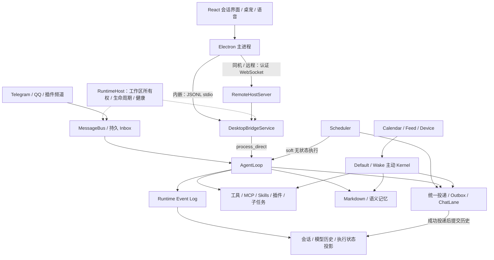

# Kaze（かぜ）

本地优先、具有长期记忆与主动交互能力的 **Personal Agent**。

Kaze 面向个人日常使用：在 Windows 桌面或 Telegram 中交流，记住跨会话的偏好与经历，调用工具处理任务，并结合日历、待办和内容源，在合适的时机主动提醒。桌面提供会话、执行工作台、语音和动画桌宠；独立 Runtime Host 负责持续运行，关闭桌面后仍可处理消息与后台任务。

会话、记忆和运行数据由自己的工作区保存。模型、Embedding、语音和外部工具按配置连接相应服务；本地优先不代表所有推理均在本机完成。

## 核心能力

| 能力 | 当前支持 |
| --- | --- |
| 多入口对话 | Windows 桌面、Telegram、NapCat QQ 与可选官方 QQBot；会话历史独立，长期记忆在同一工作区共享 |
| 长期记忆 | Markdown 画像与近期上下文、结构化语义记忆、向量与关键词混合召回、原始消息回查，以及显式记忆写入与失效 |
| 主动交互 | Wake / Default 主动管线，接入日历告警、内容候选与设备上下文，结合近期互动、去重和打扰控制决定是否推送 |
| 工具与扩展 | 文件、Shell、Web、定时任务、子任务、MCP、Skills 与原生插件，工具执行过程可在工作台追踪 |
| 常驻与恢复 | 独立 Host、Windows 登录后后台运行、远程桌面、执行事实日志、持久收发队列与受控续跑 |

主动检查、Drift 探索与联想记事本在[示例配置](config/examples/config.example.toml)中默认关闭，需要按需启用。

## 快速开始：Windows 桌面

需要 Python 3.12+、Node.js 和 pnpm（项目声明版本为 `10.33.0`）。以下命令在仓库根目录的 PowerShell 中执行。开发版默认使用仓库下的 `workspace/`；安装版使用 `%USERPROFILE%\.hasaki\workspace`。配置文件位于对应工作区的 `config.toml`。可通过 `HASAKI_WORKSPACE` 显式指定其他工作区。

```powershell
python -m venv .venv
.venv\Scripts\python.exe -m pip install -r apps/backend/requirements/development.txt
pnpm install
node apps/desktop/node_modules/electron/install.js
pnpm start  # 先构建最新代码，再启动本仓库 Electron
```

首次启动后，在“模型”页配置可用连接；示例配置中的占位密钥不能用于对话。语义记忆的 Embedding、语音服务与外部频道需分别配置，参见[配置示例](config/examples/config.example.toml)。仅使用桌面对话时不需要配置外部频道。根包名为 `kaze-agent`，桌面包名为 `kaze-desktop`；仓库文件夹可以保留原名，不影响启动。

外部频道的发送者白名单在工作区 `channels.json`，例如 `{"allow_from":{"telegram":["123456"]}}`；默认不接收未授权发送者。

工作区包含个人对话及配置，不纳入版本控制。Codex 连接凭据单独保存在工作区 `.desktop/codex-auth.bin`，Windows 使用当前用户的 DPAPI 加密；迁移到其他 Windows 用户后需要重新授权。

## 运行模式与常驻后端

三种桌面连接方式共用后端执行逻辑。同一工作区由一个后端进程持有，内嵌后端与独立 Host 不能同时占用它。

| 模式 | 生命周期 | 能力边界 |
| --- | --- | --- |
| 桌面内嵌后端 | `pnpm start`；桌面退出时释放后端 | 本地附件、语音、桌宠、模型和设置管理 |
| Windows 同机常驻 | 登录计划任务启动独立 Host，桌面自动读取部署连接文件；退出桌面只断开客户端 | 支持本机模型管理、在线切换默认模型与桌宠；聊天附件、语音及其他配置编辑仍受限制 |
| 远程 Host | 桌面通过认证的 WebSocket 连接 Host，工具在 Host 所在机器执行 | 支持文本会话、工作台、记忆与运行目录、任务读取；本地上传、语音、桌宠、Codex 登录及配置编辑未开放 |

同机能力依赖安装生成的连接文件和 Host 工作区校验；手动设置回环 URL 或 SSH 隧道不会自动获得本机权限。

先退出占用该工作区的桌面内嵌后端，再从仓库根目录运行：

```powershell
.venv\Scripts\python.exe apps/backend/main.py host --workspace ./workspace --config ./workspace/config.toml

# 在另一个终端查看状态或请求正常停止
.venv\Scripts\python.exe apps/backend/main.py host-status --workspace ./workspace
.venv\Scripts\python.exe apps/backend/main.py host-stop --workspace ./workspace
```

独立 Host 不依赖 Electron 或 stdin，可运行已配置的渠道、调度任务与主动提醒。CLI 默认路径与桌面不同，部署时应显式指定工作区和配置路径。Linux 可安装 `apps/backend/requirements/production.txt` 并使用 `.venv/bin/python`，systemd 示例见 [deploy/kaze-host.service.example](deploy/kaze-host.service.example)。启停、健康检查及恢复边界见 [Runtime Host](docs/architecture/runtime-host-v1.md)。

Windows 登录后自动运行使用 [deploy/windows-runtime.ps1](deploy/windows-runtime.ps1)，提供 `Plan`、`Install`、`Start`、`Status`、`Stop` 和 `Uninstall` 操作；完整步骤见 [Windows 本机常驻部署](docs/architecture/windows-local-host-v1.zh-CN.md)。这是当前用户登录后的常驻方案，锁屏可继续运行；注销、睡眠、休眠和关机期间无法继续工作。

## 桌面功能

| 入口 | 当前能力 |
| --- | --- |
| 对话 | 会话列表、附件、模型选择、流式生成与取消；发送首条消息时才创建会话，空白草稿重复点击“新会话”不会清空输入 |
| 工作台 | 搜索消息、筛选会话与作者、分页，查看 Tool Chain、执行事件与收发队列，对失败、中断及结果未知的执行进行核对 |
| 知识与运行 | 直观查看全局记忆文档，以及 MCP、Skills 和定时任务信息 |
| 模型 | 添加、编辑、移除 API 模型连接；提供 Codex 的 ChatGPT 订阅登录入口 |
| 桌宠 | 手动导入 ZIP、选择桌宠、显示／隐藏、拖动、动画和回复气泡 |
| 语音与后台任务 | 配置语音输入／合成、热键、定时任务和 Default／Wake 主动管线 |

工作台展示已持久化的会话记录与工具调用链路，支持长文本预览与结果追踪。当前工作台侧重于查看历史、工具链路及执行状态，不提供工作台内的消息直接编辑、撤销和删除。

内嵌后端模式保存模型连接或切换默认模型会重启后端会话服务；同机常驻模式支持在空闲时在线切换默认模型，不重启 Host。修改模型前应等待正在进行的请求完成。附件、语音、桌宠与配置管理的可用范围见上方运行模式表。Codex 授权与推理说明见 [Codex 连接说明](docs/codex-connection.md)。

## 长期记忆与主动交互

语义记忆通过向量与关键词混合召回。`recall_memory` 用于检索，`message_lookup` 用于回查原始消息证据，`memorize` 用于明确写入。回复后的记忆提取和 Markdown 维护使用持久任务与回执，避免将完整整理流程放在用户等待回复的路径中。详见[后台记忆任务](docs/architecture/durable-memory-tasks-v1.md)与 [Markdown 维护恢复](docs/architecture/durable-markdown-tasks-v1.md)。

`forget_memory` 可将已选定的 Memory2 条目或 `notebook:<note_id>` 标记失效。它按明确 ID 处理，不自动查找全部语义重复，也不删除整段原始对话。联想笔记纠错受配置会话约束，主动消费不能借此修改记忆。

联想记事本是可选的增量学习插件，与现有记忆引擎并存，复用主动 tick、候选判断与投递策略。首次启用仅接纳之后的新材料，启用后会产生模型费用；配置与消费边界见[联想记事本说明](docs/architecture/associative-notebook-release.zh-CN.md)。

主动管线通过 MCP 或插件接入三类来源：

| 来源 | 示例 | 接入文档 |
| --- | --- | --- |
| `alert` | ICS 日历、本地待办、到期提醒 | [Calendar](docs/integrations/calendar.md) |
| `content` | Feed 更新、正文缓存与版本确认 | [Feed](docs/integrations/feed.md) |
| `context` | Windows 锁屏、输入空闲、前台应用和电源状态 | [Device](docs/integrations/device.md) |

Wake 使用持久候选池，优先处理告警；Default 使用互动电量、配额与去重策略。Drift 在启用后执行配置的探索活动。候选入池或模型决定发送都不等于实际送达，成功历史以渠道回执为准。配置、频率与投递流程见[主动推送指南](docs/_handbook/proactive-guide.md)。

## 执行记录与恢复

Runtime Event Log 保存交互与执行事实，会话历史、模型历史和执行状态由这些事实投影。Inbox / Outbox 保存收发意图和回执，后台子任务的完成结果也通过持久交接返回原会话。重启可恢复已提交记录，并补齐满足条件的未完成交接；模型调用、工具或发送结果未知时保留待核对状态。

普通桌面对话支持先预览、再确认的受控续跑，仅在历史边界完整且工具结果已知等条件满足时创建关联的新执行。自动恢复进程、日志中记录 `completed` 与用户目标已验收完成是不同层面的状态；项目仍在完善长期目标闭环，不承诺任意任务自动续跑或外部投递 exactly-once。

相关说明：[执行契约](docs/architecture/execution-contract-v1.md)、[执行查看与处置](docs/architecture/execution-projection-v1.md)、[受控续跑](docs/architecture/controlled-continuation-v1.md)、[持久收发队列](docs/architecture/durable-transport-v1.md)、[队列核对](docs/architecture/transport-review-v1.md)、[工作区冷备份与隔离恢复](docs/architecture/workspace-backup-v1.md)。

## 当前架构



- 会话直接使用 `session_key`，桌面 RPC 也接受 `chat_id`。新桌面会话默认生成 `desktop:<uuid>`；外部频道使用 `<channel>:<chat_id>`。会话间消息记录独立，长期记忆共享。
- 渠道输入由总线逐项消费，桌面 chat.send 直接调用 AgentLoop。会话锁保护回合顺序，写锁保护历史更新；ChatLane 按渠道目标协调被动交互和后台推送，详见 [运行协调](docs/runtime-coordination.md)。
- `workspace/memory/` 存放 Markdown 长期记忆、历史、待整理内容及近期上下文；默认 `default_memory` 引擎使用 Memory2 保存结构化语义记忆。
- 桌宠包统一放在 `workspace/pets/`。桌宠选择属于应用，可在不同会话中使用；支持导入、切换、显示、隐藏、拖动、动画和回复气泡。
- 语音使用全局 `[voice.tts].voice_id`，热键输入发送到当前会话。模型目录的第一个注册项为全局主模型。
- 定时任务按 `session_key` 归属。Default／Wake 主动管线每轮读取工作区 `PROACTIVE_CONTEXT.md`，可选 `HEARTBEAT.md` 作为附加任务规则。主动检查默认关闭，设置中的“高级”可配置策略、会话和外部频道目标，详见 [主动推送指南](docs/_handbook/proactive-guide.md)。

核心入口：`apps/backend/bootstrap/tools.py`；会话桥接：`apps/backend/desktop_bridge/session_service.py`；前端入口：`apps/desktop/renderer/src/SessionApp.tsx`。模块职责和数据流见 [总体架构](docs/knowledge/architecture/overview.md) 与 [项目知识库](docs/knowledge/index.md)。

[桌面主链路交互架构图](docs/kaze-system-architecture.html) 提供路径演示、主题切换和导出，源码引用固定在 `53e5b24` 快照；当前主动管线以以上架构和主动推送指南为准。图源为 [kaze-system.archify.json](docs/kaze-system.archify.json)。

## 桌宠与品牌资源

软件图标及助手头像使用坐姿小风鼬，顶部导航使用蓝色风纹图标。桌宠由用户通过界面手动导入 ZIP，不随源码自动导入或选中。

原尺寸小风鼬的源文件位于 [assets/pets/kaze-wind-ferret](assets/pets/kaze-wind-ferret)。将 `pet.json` 与 `spritesheet.webp` 放在 ZIP 根目录即可导入：

```powershell
New-Item -ItemType Directory -Force output/pets | Out-Null
Compress-Archive -Path assets/pets/kaze-wind-ferret/pet.json,assets/pets/kaze-wind-ferret/spritesheet.webp -DestinationPath output/pets/kaze-wind-ferret.zip -Force
```

本地生成的 `output/` 预览和 ZIP 不包含在源码仓库中。更多制作记录见 [桌宠说明](docs/kaze-pet.md) 和 [品牌资源说明](docs/kaze-branding.md)。

## 验证与测试

桌面开发模式使用 `pnpm dev`。常用检查命令如下：

```powershell
pnpm lint
pnpm typecheck
pnpm build
pnpm test
./scripts/test-session-runtime.ps1

# Codex 连接的模拟认证与模型调用测试
$env:PYTHONPATH = "apps/backend"
.venv\Scripts\python.exe -m pytest tests/backend/test_codex_connection.py -q

# Windows 打包流程检查
pnpm --filter kaze-desktop --fail-if-no-match run test:package
```

回归测试覆盖普通会话身份、共享 Markdown 记忆、消息持久化、并发串行化、取消、定时推送、JSONL 中文通信、桌宠包与图集验证，以及保留的语音、屏幕观察和调度时间测试。真实模型、云语音和安装包仍需结合实际环境进行交互验收。

构建 Windows 安装包使用 `pnpm --filter kaze-desktop --fail-if-no-match run package:win`。完整后端测试、类型检查和隔离端到端演练见[测试说明](tests/README.md)。

## 桌面远程连接

桌面可通过 `KAZE_RUNTIME_URL` 与 `KAZE_RUNTIME_TOKEN_FILE` 连接独立 Runtime Host，共用服务器的会话、执行记录和 Calendar 待办。远程模式不启动本地后端；没有显式环境变量时，优先使用同机部署连接文件，文件也不存在时才启动内嵌后端。连接文件无效或连接失败不会自动回退到内嵌模式。启动、TLS/SSH 接入、断线恢复和功能边界见 [远程桌面说明](docs/architecture/remote-desktop-v1.md)。

会话历史由 Runtime Event Log 中的会话事实重建，兼容旧历史并保留本地／远程模式。
迁移、崩溃恢复边界和离线重建命令见 [可重建会话投影](docs/architecture/conversation-projection-v1.md)。

## 启动隔离

应用显示名为 Kaze。Windows App ID 为 `com.hasaki.agent`。在申请单实例锁之前设置独立的 `userData` 和 `sessionData`，缓存位于工作区 `.desktop/user-data/chromium/`，按工作区隔离缓存与实例。

启动路径诊断记录在工作区 `.desktop/user-data/desktop-diagnostics.log` 的 `runtime.paths` 事件中，包含实际后端程序、工作目录和缓存目录。`HASAKI_DESKTOP_USER_DATA_DIR` 可显式覆盖桌面数据目录。

## 更多文档

- [文档中心](docs/README.md)：使用、集成与设计文档索引。
- [项目知识库](docs/knowledge/index.md)：模块职责、调用流程与修改影响。
- [Personal Agent 路线](docs/architecture/personal-agent-delivery-roadmap.zh-CN.md)：产品目标、阶段交付与待完善项。

## 开源许可证 (License)

本项目采用 [MIT 许可证](LICENSE)。

第三方资源与组件许可：

- **字体**：霞鹜文楷（LXGW WenKai），遵循 [SIL Open Font License 1.1](apps/desktop/renderer/public/licenses/OFL-LXGW-WenKai.txt)。
