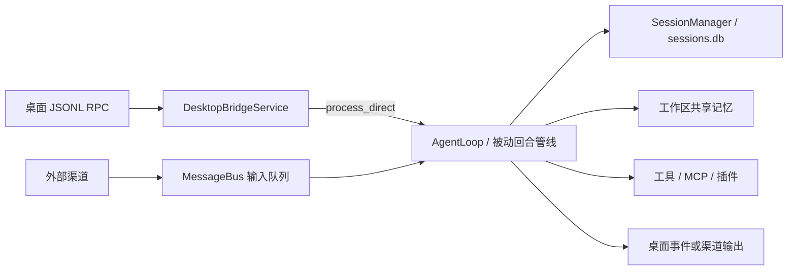

# 总体架构

Kaze 由 Electron / React 桌面端和 Python 后端组成。后端以 `session_key` 标识会话，通过 SessionManager 保存消息；身份配置、Markdown 长期记忆、模型与桌宠配置属于工作区。

## 启动与装配

`main.py` 是进程入口。`bootstrap/app.py` 的 AppRuntime 管理启动、后台循环和关闭，`bootstrap/tools.py` 的 build_core_runtime 装配 Provider、AgentLoop、消息总线、会话、工具、调度器、记忆、插件和推送同步服务。`bootstrap/wiring.py` 提供上下文、记忆插件、工具集和生命周期进度的接线。

## 输入与执行

桌面 chat.send 直接调用 AgentLoop.process_direct；外部渠道将 InboundMessage 放入总线，由 AgentLoop.run 消费。被动管线准备上下文和检索结果，进入模型与工具循环，再解析回复、保存消息并发布生命周期事件。

## 主动与调度

主动入口为 AppRuntime → KazeProactiveLoop → ProactiveKernel。Default / Wake 插件提供主动执行图，处理 alerts、content、context 三路输入，以及独立持久化状态的 Drift 活动。

Scheduler 的 instant 任务直接生成正文；soft 任务在内部执行 key 下运行无状态 Agent。主动与调度使用 MessagePushTool 和共享 ChatLane，取得发送成功回执后，宿主才向目标会话提交助手历史并通知桌面。

## 状态归属

| 状态 | 所属模块 |
| --- | --- |
| 会话元数据与消息历史 | `session/`，持久化到 `sessions.db` |
| 全局配置与主动身份 | 工作区配置和 `memory/VEDA.md` 或 `SOUL.md` |
| 检索、长期记忆与整理 | `core/memory/` 契约、选用的记忆插件及 `memory2/` |
| 外部图片推送与回合消息同步 | `conversation/push_sync.py`，写入 SessionManager |
| 定时任务 | `agent/scheduler.py` |
| 主动候选、去重、额度及 Drift | `proactive_v2/` 与相应插件 |
| 渠道适配与发送 | `core/channels/`、`infra/channels/` 与渠道插件 |

`conversation/` 的职责是推送同步。会话查询、消息存储、历史提交和桌面快照分别由 SessionManager、TurnOrchestrator 和 DesktopBridgeService 完成。

## 运行协调

同一执行会话的普通回合由 AgentLoop 会话锁串行化；SessionManager 写锁保护历史更新，ProcessingState 记录目标会话忙状态。ChatLane 按归一化后的渠道和接收方协调推送，让被动交互优先，并覆盖实际发送及发送后的提交。

渠道 AgentLoop.run 当前逐项等待回合完成。桌面直接入口可执行不同会话的请求；会话锁和 ChatLane 的存在本身不能证明所有入口都支持跨会话并行。详细范围见 [运行协调说明](../../runtime-coordination.md)。
