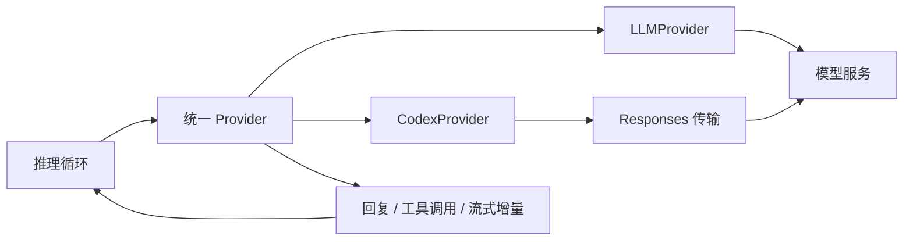

# 模型 Provider 流程

模型调用由 Python 后端的 Provider 层封装。Agent 推理循环消费统一的回复、工具调用和流式结果，桌面通过桥接接收进度与正文。

## 装配与选择

`bootstrap/providers.py` 的 build_providers 读取全局模型配置。模型目录第一个注册项作为主模型；普通连接创建 LLMProvider，Codex 连接创建 CodexProvider。主动运行时可以根据主动配置构建自己的 Provider。

## 普通模型路径

`infra/providers/llm_provider.py` 暴露 LLMProvider 接口，主要实现位于 `agent/provider.py`。Provider 处理请求策略、超时、响应解析和工具调用流，将服务端结果转换成 Agent 使用的 LLMResponse / ToolCall 等结构。

## Codex 路径

`agent/model_runtime/provider.py` 封装 CodexProvider；Responses 传输、模型目录和授权存储分别位于 model_runtime 的 transports、catalog 和 auth 模块。

授权管理由桌面 codex 服务调用后端接口。凭据保存在工作区 `.desktop/codex-auth.bin`，模型请求由后端读取授权并通过传输层完成。

## 数据流

## 修改影响

修改 Provider 时核对配置解析、请求转换、工具调用、增量合并、超时与取消、错误传播，以及桌面模型目录和授权界面。远程模型验证与本地模拟传输测试分别覆盖不同边界。
