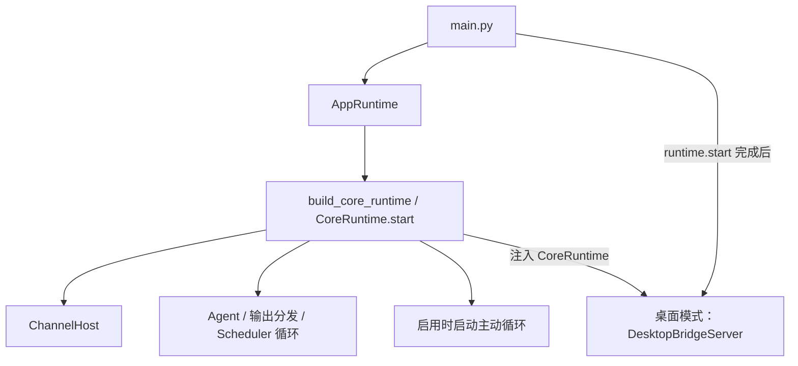

# 启动与关闭流程

## 启动

1. `main.py` 解析运行模式和工作区配置，进入对应运行入口。
2. AppRuntime 调用 build_core_runtime：准备工作区，创建 Provider、MessageBus、EventBus、SessionManager、工具、Scheduler、记忆、ProcessingState 与图片推送同步服务。
3. AgentLoop 接收这些依赖；bootstrap 绑定 Scheduler 的无状态执行入口和发送成功后的历史提交回调，并连接生命周期进度事件。
4. CoreRuntime.start 加载插件、主动能力与 MCP，ChannelHost 启动配置启用的渠道。
5. AppRuntime 启动 AgentLoop.run、总线输出分发和 Scheduler.run。启用主动检查时，再准备并启动主动循环。
6. 桌面入口在 AppRuntime.start 完成后构造 DesktopBridgeServer(core_runtime)，处理 JSONL 请求；DesktopBridgeService 直接调用同一 AgentLoop 和会话服务。

## 关闭

AppRuntime 停止 AgentLoop、总线与 Scheduler，取消并等待应用后台循环。随后调用 Scheduler.aclose，等待已进入的发送后历史提交完成，再终止插件、关闭 MCP 和 EventBus。

渠道、记忆后台资源与共享 HTTP 资源继续关闭，最后关闭 SessionStore。CoreRuntime.stop 也调用 Scheduler.aclose，因此该操作可重复进入。

DesktopBridgeServer 在输入结束或进程退出时关闭请求调度、桌面服务和输出 writer。修改关闭顺序时，应确保提交任务使用的会话、事件和渠道服务仍可用。

## 排查入口

- 工作区和配置：`main.py`、`core/common/workspace.py`。
- 依赖构建与回调：`bootstrap/tools.py`、`bootstrap/wiring.py`。
- 插件与 MCP：CoreRuntime.start / stop。
- 后台循环与资源关闭：AppRuntime.start / shutdown、Scheduler.aclose。
- 桌面请求与进程通信：DesktopBridgeServer、request_dispatcher、stream_writer。
